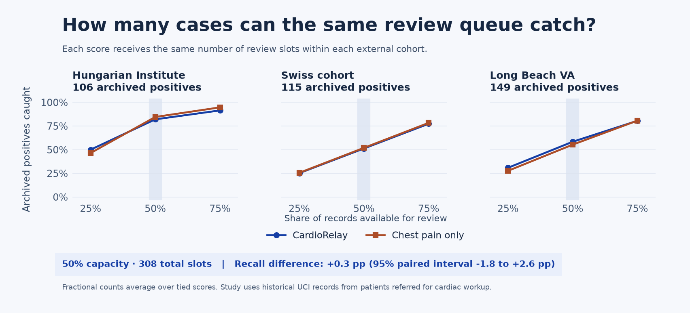

# CardioRelay

**AI + Health · Veritas AI International High School Hackathon 2026 · Brief 4.1.2**

CardioRelay helps a quality-improvement nurse audit a simulated referral queue on historical heart disease records. It asks two questions. Does a cutoff chosen in Cleveland keep catching the same share of cases at other hospitals? If the nurse can give both rules the same number of review slots, which rule catches more?

**This project is a prototype and is not medical advice.**

At their Cleveland cutoffs, the two rules differed by 13 missed Swiss cases and 13 review slots. With the same slots, that gap was fewer than one expected case. Across all three external sites at half capacity, CardioRelay caught about one additional positive case in total. The uncertainty interval includes zero.

## Test 1 · Does the Cleveland cutoff travel?

**The threshold reached 86% recall in Cleveland validation. Recall fell to 71% on the Cleveland holdout and ranged from 65% to 78% across the three external cohorts.** The tradeoff was clearest in Hungary: compared with the chest pain rule, the model sent 37 fewer records for review and missed 18 more positives.

| Test cohort | Records | Positive labels | AUROC | Recall | Reviewed | False positives | Missed positives |
|---|---:|---:|---:|---:|---:|---:|---:|
| Cleveland holdout | 61 | 28 | 0.877 | 71% | 25 | 5 | 8 |
| Hungarian Institute | 294 | 106 | 0.823 | 65% | 97 | 28 | 37 |
| Swiss cohort | 123 | 115 | 0.736 | 76% | 89 | 2 | 28 |
| Long Beach VA | 200 | 149 | 0.707 | 78% | 142 | 26 | 33 |

In Switzerland, the chest pain rule missed 15 of 115 positives, compared with 28 for CardioRelay. Both raised two false flags, but the chest pain rule reviewed 102 records while CardioRelay reviewed 89. Different workloads prompted a second comparison with the same number of slots.

Among the 12 positive Hungarian records coded female, CardioRelay flagged zero (95% Wilson interval for recall: 0%–24%). This small subgroup is a priority for further audit.

## Test 2 · Which rule does more with the same review slots?

At half capacity, each rule got 308 review slots across the three external cohorts. CardioRelay caught 233 of 370 archived positives versus an expected 231.8 for the chest pain rule. The recall difference was **+0.31 percentage points** (95% paired bootstrap interval **−1.77 to +2.60 points**). These records leave room for either rule to do better. The point estimate favored CardioRelay at Long Beach VA and favored the simpler rule in Hungary and Switzerland.



| External cohort at 50% capacity | Slots per rule | Archived positives | CardioRelay caught | Chest pain caught (expected) |
|---|---:|---:|---:|---:|
| Hungarian Institute | 147 | 106 | 87 | 89.6 |
| Swiss cohort | 61 | 115 | 59 | 59.8 |
| Long Beach VA | 100 | 149 | 87 | 82.4 |
| **Pooled external** | **308** | **370** | **233** | **231.8** |

See the [machine-readable results](results.json) for the underlying counts, group denominators, and uncertainty intervals.

## Try the demo

Download the repository and open [demo.html](demo.html) in a browser. The demo runs offline and displays results calculated by the analysis script.

In **Fixed cutoffs**, select **Swiss cohort**. Compare the two rules at their original Cleveland cutoffs. Then open **Same review budget** at **50%**. Both rules get 61 slots, and the original gap of 13 misses shrinks to fewer than one expected miss. Switch to **Long Beach VA** to see how the estimated difference changes at the same percentage.

## What we added

The suggested project predicts archived heart disease from checkup measurements and invites teams to test across hospitals. CardioRelay adds a specific audit task and a separate comparison at equal review capacity. This lets the nurse distinguish how well a cutoff transfers from whether the model improves the ranking when review slots are scarce. The original dataset researchers also studied transfer across hospitals. [Veritas AI Project Briefs](https://highschoolhackathon.org/briefs) · [Original multicenter study](https://pubmed.ncbi.nlm.nih.gov/2756873/)

## Data and evaluation

The UCI Heart Disease archive contains 920 records from Cleveland (303), Hungary (294), Switzerland (123), and the Long Beach VA (200). The target `num` records archived disease status based on angiography. We map `0` to negative and `1–4` to positive. The classifier uses four fields intended to represent information available at intake: age, recorded sex, chest pain category, and resting blood pressure. The analysis excludes lab, ECG, stress test, and later diagnostic fields. [UCI Heart Disease](https://archive.ics.uci.edu/dataset/45/heart+disease)

**Fit and cutoff selection.** We split Cleveland records into 181 for fitting, 61 for choosing the threshold, and 61 for the internal test. We stratified the split by the archived label and fixed the random seed at 42. A preprocessing pipeline fits median imputation and scaling for numeric fields and most-frequent imputation and one-hot encoding for categories on the training set. Logistic regression uses the same training rows. A simpler rule scores each chest pain category by its training-set positive-label rate.

**Fixed cutoffs.** Each learned rule uses the highest threshold that flags at least 85% of positive records in Cleveland validation. CardioRelay’s threshold was 0.535, which flagged 24 of 28 validation positives. The scores and cutoffs stayed fixed for the Cleveland holdout and the three external sites. Flag-all and flag-none show the endpoints of review workload. AUROC describes ranking across all cutoffs; recall and review counts describe what happens with the one chosen cutoff.

**Same review budget.** This exploratory follow-up was prompted by the unequal workloads in the first test. Before running it, we chose capacities of 25%, 50%, and 75% (rounded down within each cohort), with 50% as the primary comparison. Each rule fills the same number of slots from highest score to lowest. When the last slot falls inside a tie, expected counts average over all equally likely choices among the tied records. This analysis uses the original Cleveland scores without selecting a new operating threshold. The paired bootstrap takes 3,000 draws within site, keeps both scores with each record, then recomputes both rankings. The interval captures sampling uncertainty within these observed sites.

The [data attribution](DATA_ATTRIBUTION.md) describes the reduced public snapshots. In the Long Beach VA cohort, 57 of 200 records required blood-pressure imputation.

To reproduce the figures and counts in the JSON from the bundled UCI data, run these commands from the repository directory with Python 3.10 or later.

```sh
python3 -m venv .venv
source .venv/bin/activate
python -m pip install -r requirements.txt
python evaluate.py
```

The script writes `results.json`. On Windows PowerShell, activate the environment with `.venv\Scripts\Activate.ps1`.

## Limits and next steps

The records come from historical cohorts referred for cardiac workup. The target captures angiographic status recorded at that time. The experiment estimates how this audit would have behaved on those records. It cannot tell us whether a second review would improve outcomes or whether scores transfer to contemporary patients. Differences in prevalence, record completeness, and the types of patients seen at each hospital can affect performance. For example, the Swiss cohort has only eight negative records.

The next test would use a current, separate dataset with documented referral timing and fields available at review time. A clinical team would need to define the review capacity and compare the audit against its existing workflow before considering any prospective use.

## Sources and credits

- Janosi, A., Steinbrunn, W., Pfisterer, M., & Detrano, R. (1989). *Heart Disease*. UCI Machine Learning Repository. The dataset is distributed under [CC BY 4.0](https://creativecommons.org/licenses/by/4.0/). [Dataset and field documentation](https://archive.ics.uci.edu/dataset/45/heart+disease) · [Dataset DOI](https://doi.org/10.24432/C52P4X)
- Project starting point and submission format. [Veritas AI Project Briefs](https://highschoolhackathon.org/briefs)
- Presentation references and their role. [Judging and project examples](judging-notes.md)
- Modeling and data tools. [scikit-learn](https://scikit-learn.org/) · [pandas](https://pandas.pydata.org/) · [NumPy](https://numpy.org/)
- AI assistance. [OpenAI Codex](https://openai.com/codex/) assisted with concept development, code, evaluation, and drafting the submission materials.

[One-page write-up](CardioRelay_Writeup.pdf) · [Submission checklist and demo script](submission.md)
